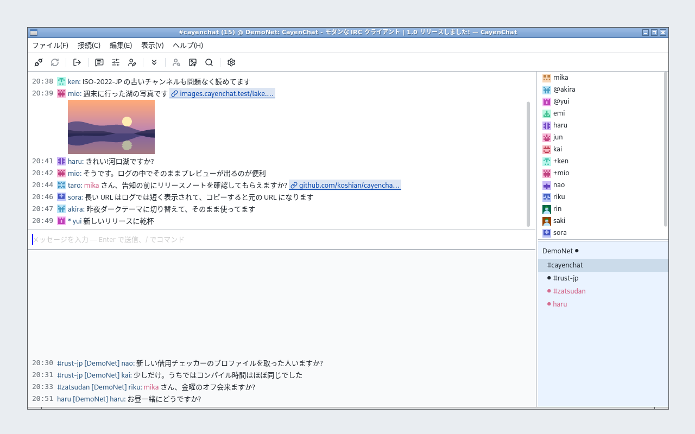

# CayenChat

[English README](README.md)

Rust と GPUI で作った、macOS・Windows・Linux 向けのコンパクトなネイティブ IRC クライアントです。

- 複数サーバーへの同時接続（サーバーごとにニックネーム、自動参加チャンネル、TLS、SASL を設定）
- UTF-8、ISO-2022-JP、Shift_JIS、EUC-JP に対応
- パスワードは OS の資格情報ストアに保存
- 自分の画像ホスティングアカウント（ImgBB）経由で画像を共有
- 日本語・英語 UI



## ビルドと起動

Rust 1.88 以降が必要です。

```sh
cargo run --locked -p cayenchat-ui
```

macOS では開発用の `.app` バンドルも作れます。

```sh
sh scripts/bundle-macos.sh
open target/CayenChat.app
```

プラットフォームごとの前提条件と確認手順は[開発要件](spec/development.md)を参照してください。

## 使い方

起動時に開く設定ウィンドウ（`Cmd+,` / `Ctrl+,`）でサーバーを追加し、**接続**を押します。[キーボードショートカットと IRC コマンド](SHORTCUTS.ja.md)も参照してください。

## ヒント

- **Tiarra 経由や ISO-2022-JP のサーバーでアバターを見てもらう(ピアアバター)。** KVIrc の「アバターあり」の目印は ISO-2022-JP では壊れるため、ISO-2022-JP のサーバーでは、代わりに他のクライアントに表示されない見えない目印(制御コード)を実名の先頭に自動で付けます(次の接続から反映)。既定でオンで、IRCv3 タブの「実名の先頭に見えない目印を付ける」で切り替えられます(ISO-2022-JP のサーバーでピアアバターがオンのときだけ表示)。この目印を見かけた CayenChat があなたのアバターを問い合わせます。KVIrc はこの目印を認識しません。bouncer 経由ではサーバーに送る実名が bouncer の設定のものなのでスイッチは効きません。bouncer のそのネットワークの実名の先頭に、文字列 `\x034\x03`(ASCII の 9 文字で、制御文字ではありません)を書いてください(Tiarra はネットワークのブロックの `name:`、例: `name: \x034\x03いつもの実名`。soju は `network update <ネットワーク名> -realname '\x034\x03いつもの実名'`)。他のクライアントではこの文字がそのまま見え、KVIrc は認識しません。[D025](spec/decisions.md) と [D057](spec/decisions.md) を参照してください。

## 会話ログ

会話のファイル保存は初期値でオフです。「アプリケーション」設定で、チャンネルの会話と、別に個人宛ての会話(こちらもあなたのディスクに残ります)をオンにし、保存先フォルダー(初期値はデータディレクトリの `CayenChat/logs`)を選びます。CayenChat は会話ごと・日ごとに UTF-8 のテキストへ追記します(`<フォルダー>/<サーバー>/channels/<チャンネル>/<日付>.log`、`<フォルダー>/<サーバー>/private/<nick>/<日付>.log`)。各行は `時刻`・`種類`(`msg`、`action`、`notice`、`join`、`part`、`quit`、`nick`、`kick`、`topic`、`mode`)・`nick`・`本文` をタブで区切ります。モード変更のうち保存するのはオペレーター権限とボイス権限の変更(`+o nick`)だけで、キーやban、その他のモードは保存しません。パスワード、サーバーのログ、サーバーから取得した履歴は保存しません。オフにすると書き込みを止め、ファイルは残します。形式は [D044](spec/decisions.md) にあります。

## UI 文言のカスタマイズ

CayenChat は、同梱の `locales/ja.json` と `locales/en.json` を実行時に読み込みます。これらのファイルを編集すると、UI の文言をローカルで変更（上書き）できます。外部ファイルが見つからない場合は、実行ファイルに埋め込まれたカタログを使います。

## ドキュメント

[`spec/`](spec/) 以下の仕様書が基準です。まず[アーキテクチャ](spec/architecture.md)と[機能の実装状況](spec/feature-parity.md)を参照してください。テストの実行とカバレッジの確認は[テストの方法](HOW_TO_TEST.ja.md)を参照してください。Linux・macOS・Windowsでのスクリーンショット再撮影手順は[撮影ガイド](scripts/screenshots/README.ja.md)にまとめています。

## ライセンス

- コアのクレート（`crates/model`、`irc-core`、`storage`、`media`、`upload`、`app`）は [Mozilla Public License 2.0](licenses/MPL-2.0.txt) です。GPUI に依存しておらず、誰でもこれを使って独自のユーザーインターフェースを作り、公開できます。
- GPUI のデスクトップアプリ（`crates/ui`）と、リポジトリ内のそれ以外のものは、GPL バージョン 3 のみです（[LICENSE](LICENSE)）。GPUI 由来の `crates/ui/src/input.rs` は Apache-2.0 のままです。
- vendor したクレートと外部の依存には、それぞれのライセンスが適用されます（[告知](THIRD_PARTY_NOTICES.md)）。

ソースコードは <https://github.com/koshian/cayenchat> で入手できます。0.9.x までのリリースは GPL バージョン 3 のみで公開されました。貢献のライセンスについては [CONTRIBUTING](CONTRIBUTING.md) を参照してください。
