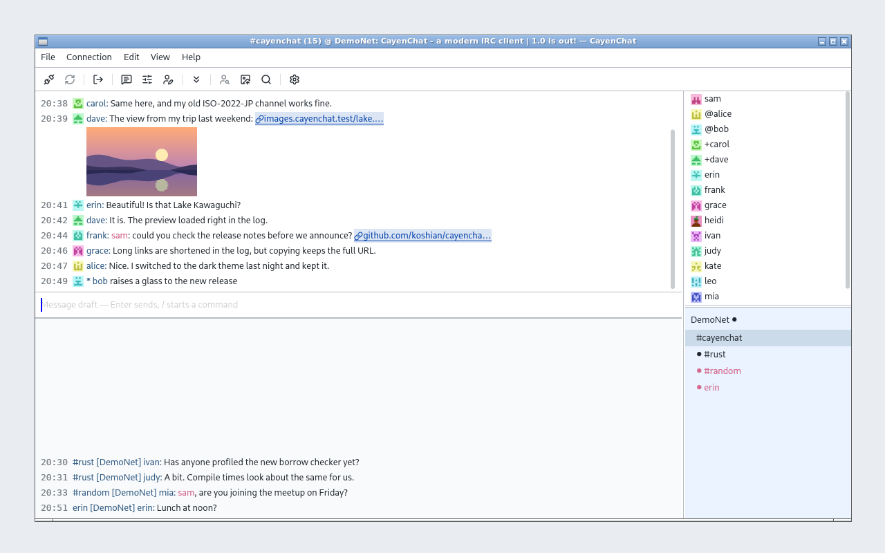

# CayenChat

[Japanese README](README.ja.md)

A compact native IRC desktop client written in Rust and GPUI, for macOS, Windows and Linux.

- Multiple servers at once, with per-server nickname, auto-join channels, TLS and SASL
- UTF-8, ISO-2022-JP, Shift_JIS and EUC-JP encodings
- Passwords kept in the OS credential store
- Image sharing through your own image hosting account (ImgBB)
- Japanese and English UI



## Build and run

Requires Rust 1.88 or later.

```sh
cargo run --locked -p cayenchat-ui
```

On macOS, you can also build a development `.app` bundle:

```sh
sh scripts/bundle-macos.sh
open target/CayenChat.app
```

See [development requirements](spec/development.md) for platform prerequisites and checks.

## Usage

Add a server in the settings window that opens at startup (`Cmd+,` / `Ctrl+,`), then choose **Connect**. See [keyboard shortcuts and IRC commands](SHORTCUTS.md).

## Tips

- **Avatars through Tiarra, or on ISO-2022-JP servers (peer avatars).** KVIrc's mark for "has an avatar" cannot survive ISO-2022-JP, so on those servers CayenChat adds an invisible mark (control codes that other clients do not display) to the start of the real name instead, from the next connection. It is on by default; the switch "Start the real name with an invisible mark" is in the IRCv3 tab, shown for ISO-2022-JP servers with peer avatars on. CayenChat clients that see the mark ask you for your avatar; KVIrc does not recognize it. Through a bouncer the switch has no effect, because the bouncer sends its own real name: the mark has to be written in the bouncer's real name for that network. See [Bouncer setup](https://github.com/koshian/cayenchat/wiki/Bouncer-setup) on the wiki for how. See [D025](spec/decisions.md) and [D057](spec/decisions.md).

## Conversation logs

Saving conversations to files is off by default. In the Application settings, turn on channel conversations and, separately, private conversations (they are written to your disk too), and choose the folder (by default `CayenChat/logs` in your data directory). CayenChat appends one UTF-8 text file per conversation and day, `<folder>/<server>/channels/<channel>/<date>.log` and `<folder>/<server>/private/<nick>/<date>.log`, each line being `time`, `kind` (`msg`, `action`, `notice`, `join`, `part`, `quit`, `nick`, `kick`, `topic`, `mode`), `nick` and `text` separated by tabs. Of mode changes only operator and voice changes (`+o nick`) are saved; keys, bans and other modes are not. Passwords, the server log and history fetched from the server are never saved. Turning a log off stops writing and keeps the files. The format is specified in [D044](spec/decisions.md).

## Customizing UI text

CayenChat loads the packaged `locales/ja.json` and `locales/en.json` at runtime. Edit these files to customize or override UI text locally. If the external files are missing, CayenChat falls back to the catalogs embedded in the executable.

## Documentation

The specifications under [`spec/`](spec/) are authoritative; start with [architecture](spec/architecture.md) and [feature parity](spec/feature-parity.md). To run the tests and view their coverage, see [How to test](HOW_TO_TEST.md). To retake Linux, macOS or Windows screenshots, see the [screenshot capture guide](scripts/screenshots/README.md).

## License

- The core crates (`crates/model`, `irc-core`, `storage`, `media`, `upload` and `app`) are under the [Mozilla Public License 2.0](licenses/MPL-2.0.txt). They do not depend on GPUI, and anyone may build and publish their own user interface on them.
- The GPUI desktop application (`crates/ui`) and everything else in this repository are under GPL version 3 only ([LICENSE](LICENSE)). `crates/ui/src/input.rs`, adapted from GPUI, remains Apache-2.0.
- Vendored and third-party dependencies keep their own licenses ([notices](THIRD_PARTY_NOTICES.md)).

The source code is available at <https://github.com/koshian/cayenchat>. Releases up to 0.9.x were published under GPL version 3 only. See [CONTRIBUTING](CONTRIBUTING.md) for how contributions are licensed.
